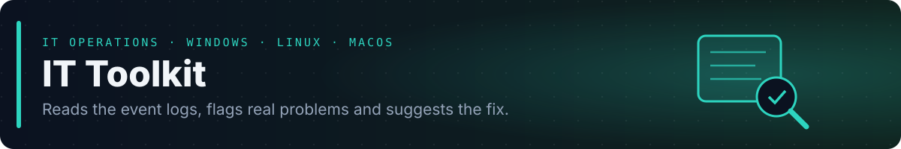

<!--
  IT Toolkit — README
  Created by Redfox using Claude
-->

<div align="center">



<br />

[](https://github.com/RafaDevpt/it-toolkit/actions/workflows/ci.yml)
[](https://github.com/RafaDevpt/it-toolkit/releases/latest)


<br /><br />

<a href="https://github.com/RafaDevpt/Personal-AI-Projects"></a>
<a href="https://github.com/RafaDevpt/it-toolkit/releases/latest"></a>

<sub>Part of <a href="https://github.com/RafaDevpt/Personal-AI-Projects"><b>Personal AI Projects</b></a> by Redfox</sub>

</div>

# 🔧 IT Toolkit

> **Diagnostics suite for daily IT operations — Windows, Linux and macOS**

---

## What it does

Most Windows troubleshooting starts the same way: open Event Viewer, scroll through thousands of entries, recognise the three or four that actually matter, and remember what they meant last time.

IT Toolkit collapses that into a single window. It reads the machine's event logs, **flags the entries that indicate a real problem, explains what each one means, and suggests a remediation** — then compiles the findings into a report ready to hand over or attach to a ticket.

Everything else in the toolkit exists for the same reason: the checks an IT team runs twenty times a week, one click away instead of five.

---

## Modules

| Module | What it covers |
| :--- | :--- |
| 🏠 **Dashboard** | System health at a glance — uptime, resource pressure, outstanding warnings |
| 📋 **Event Logs** | Reads System / Application / Security logs, filters noise, classifies severity and **suggests fixes** |
| 🌐 **Network** | Adapter state, IP configuration, DNS resolution, connectivity and port checks |
| ⚡ **Quick Tools** | The one-liners repeated daily — cache flushes, service restarts, spooler resets |
| 💾 **Disks** | Volume usage, free space thresholds, SMART status where available |
| ⚙️ **Services** | Service state, startup type, start / stop / restart |
| 📊 **Inventory** | Hardware and software inventory, OS build, installed updates |
| 📄 **Reporting Centre** | Exports findings from any module into a single readable report |

---

## Requirements

| | |
| :--- | :--- |
| **OS** | Windows 10 / 11 |
| **Python** | 3.11 or newer |
| **Privileges** | Standard user for most modules; some event log and service operations require elevation |

---

## Installation

```bash
git clone --branch it-toolkit --single-branch https://github.com/RafaDevpt/Personal-AI-Projects.git
cd Personal-AI-Projects
python -m venv .venv
.venv\Scripts\activate
pip install -r requirements.txt
```

---

## Usage

Launch with the included batch file:

```
run.bat
```

Or directly:

```bash
python main.py
```

The launcher activates the virtual environment and starts the GUI, so it works from a shortcut or a USB stick without touching the system Python.

---

## Design notes

<details>
<summary><b>Why Python + CustomTkinter</b></summary>

<br />

PowerShell with WPF was the obvious first choice for a Windows admin tool, but the UI work becomes disproportionate very quickly and distribution means signing or relaxing execution policy.

Python with CustomTkinter gives a modern-looking interface with far less markup, and packages into a folder that runs anywhere without an installer.

</details>

<details>
<summary><b>Read-only by default</b></summary>

<br />

Every diagnostic module only reads. Anything that changes system state — restarting a service, clearing a cache — is an explicit action behind a confirmation, never part of a scan.

</details>

<details>
<summary><b>Event log interpretation</b></summary>

<br />

Events are matched against a rule set of known Event IDs and sources, each carrying a plain-language explanation and a suggested remediation. Unknown events are still surfaced by severity, so nothing is silently dropped.

</details>

---

## Roadmap

- [ ] Remote machine support
- [ ] Scheduled unattended scans
- [ ] Report export to PDF
- [ ] Configurable rule set for event interpretation

---

## Licence

GPL-3.0 — see [`LICENSE`](LICENSE) in the repository root.

<div align="center">
<sub>Created by Redfox using Claude</sub>
</div>
